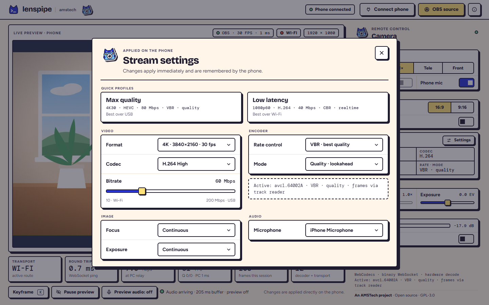
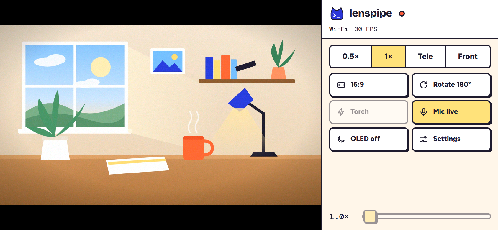
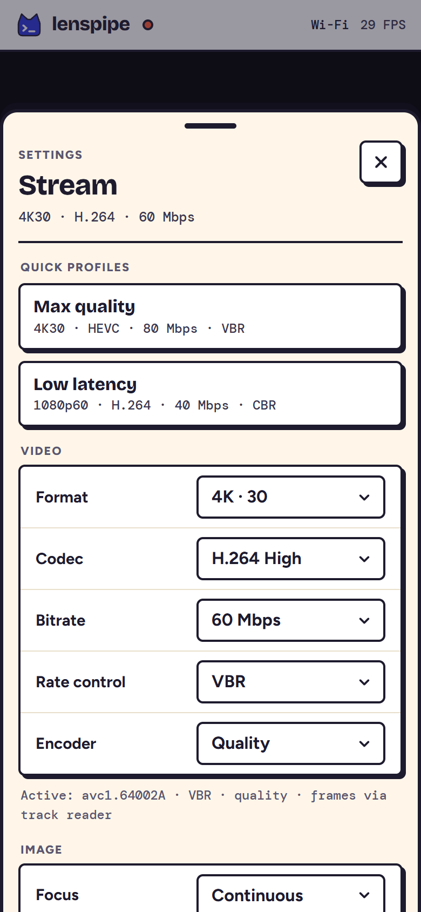

  

  <a href="#install">Install</a> ·
  <a href="#connect-your-phone">Connect</a> ·
  <a href="#use-it-in-obs">OBS</a> ·
  <a href="#settings">Settings</a> ·
  <a href="#troubleshooting">Troubleshooting</a> ·
  <a href="#security-and-privacy">Security</a> ·
  <a href="docs/DEVELOPMENT.md">Development</a>

Use your phone (**iPhone or Android**) as a low-latency studio camera on your PC and in OBS, over a USB cable or Wi-Fi. The phone only needs its browser: no app, no account, no cloud. Video never leaves your local network.

  

## Features

- **Up to 4K60**, H.264 or HEVC, `10–200 Mbps`, with **Max quality** and **Low latency** profiles.
- **Low delay**: the stream drops frames rather than building lag when the link is slow.
- **Remote control from the PC**: lens, zoom, focus, exposure, torch, aspect (16:9 / 9:16 / 4:3), rotation and phone mic.
- **Ready for OBS**: a Browser source URL, with phone audio.
- **Problems explained**: when the cable, Wi-Fi, phone or PC can't keep up, both screens say which one and offer a one-tap fix.

## Requirements

| | |
| --- | --- |
| **PC** | Windows, macOS or Linux |
| **Phone** | iPhone with iOS 16.4+ (Safari), or Android with Chrome / Edge |
| **Connection** | USB cable with Personal Hotspot (iPhone) or USB tethering (Android) — recommended — or the same Wi-Fi / LAN |

Tested mainly on iPhone, and on Android (Samsung Galaxy, Chrome). Lenses, HEVC and maximum bitrate vary between Android phones; LensPipe lowers the settings by itself when the phone refuses one.

## Install

Download the installer for your system from [Releases](../../releases):

| System | File |
| --- | --- |
| Windows | `.exe` (recommended) or `.msi` |
| macOS | `.dmg` (Apple Silicon or Intel) |
| Linux | `.AppImage` or `.deb` |

> [!NOTE]
> The installers are not signed yet. On Windows, choose **More info → Run anyway**. On macOS, open the app once, then allow it in **System Settings → Privacy & Security → Open Anyway**.

- Closing the window keeps LensPipe running in the **system tray**, so OBS keeps the camera. Use **Quit LensPipe** in the tray menu to stop it.
- Settings, certificates and the pairing key are kept in `%APPDATA%\LensPipe` (Windows), `~/Library/Application Support/LensPipe` (macOS) or `~/.local/share/lenspipe` (Linux).

To run it from source instead (Node.js 20+): `npm install && npm run build && npm start`, then open `https://localhost:8443/control`. See [Development](docs/DEVELOPMENT.md).

## Connect your phone

Click **Connect phone** in the studio and scan a QR code with the phone's camera.

**USB cable (recommended, most stable)**
- **iPhone:** plug in the cable, tap **Trust**, then turn on **Settings → Personal Hotspot → Allow Others to Join**. Mobile data is not needed.
- **Android:** plug in the cable and turn on **USB tethering** (usually **Settings → Connections → Mobile Hotspot and Tethering**).
- Scan the **USB cable** QR code.

**Wi-Fi / LAN:** put the phone and the PC on the same network and scan the **Wi-Fi / LAN** QR code.

  

The first time, the phone warns about the certificate, because it is created on your PC and not by a public authority. Tap **Show Details → visit this website** (iPhone) or **Advanced → Proceed** (Android). Then tap **Start camera**.

## Use it in OBS

1. In the studio, click **OBS source** and copy the URL.
2. In OBS, add **Sources → Browser**, paste the URL, set the size to your canvas (e.g. `1920 × 1080`) and check **Use custom frame rate** (`60`).
3. For the phone's sound, check **Control audio via OBS**.

- **OBS on the same PC as the app:** the copied URL is `http://127.0.0.1:…/obs` and works as is.
- **OBS on another PC**, or LensPipe run from source: OBS must trust the local certificate. Click **Trust for OBS (1 click)** in the same dialog, or run the command it shows, then restart OBS.
- For best performance, minimize the studio or click **Pause preview** so OBS gets the GPU decoder to itself.

## Settings

Open **Settings** in the studio's Stream panel, or on the phone. Changes apply at once and the phone remembers them.

  

| Profile | Format | Codec | Bitrate | Best for |
| --- | --- | --- | --- | --- |
| **Default** | 4K30 | H.264 | 60 Mbps | Good detail, decodes on almost any PC |
| **Max quality** | 4K30 | HEVC | 80 Mbps | USB cable |
| **Low latency** | 1080p60 | H.264 | 40 Mbps, realtime | Busy Wi-Fi, fast motion |

- Formats: `4K60`, `4K30`, `1080p60`, `1080p30` (16:9) and `12 MP`, `1440p`, `1080p60` (4:3, full sensor; on iPhone they come from photo mode, with less processing).
- The aspect is locked: the picture never rotates by itself. **Rotate 180°** is for upside-down mounts.
- On the phone, **OLED off** turns the screen black while streaming; hold for 2 seconds to wake it.
- In the studio, click the preview to focus, and press `K` to recover a smeared or frozen picture.
- `/diag` on the phone tests which formats each lens really supports.

The phone, streaming held sideways, and its own settings:

  
  

## Troubleshooting

| Problem | Fix |
| --- | --- |
| The page never loads on the phone over USB (Windows) | Windows put the USB network on **Public**. **Connect phone** shows a one-line PowerShell command to allow it, or set that network to **Private** in **Settings → Network & internet**. |
| The page never loads over Wi-Fi | Same network? Turn off VPNs and the router's guest / client isolation, and allow LensPipe through the firewall on **Private** networks. |
| The phone says **Not paired** | Scan the QR code again (some browsers drop the key while accepting the certificate). |
| The picture stutters or lags | Follow the warning shown on screen. Usually: use the USB cable, lower the bitrate, or switch HEVC → H.264. The iPhone USB link on Windows is limited to ~100 Mbps. |
| OBS shows nothing | Use the URL from **OBS source** as is, and trust the certificate if OBS is on another PC. |
| Unpair every device | Quit LensPipe, delete `certs/pairing-token` in the data folder (above) and start it again. |

## Security and privacy

- Everything stays on your network: no cloud, no account, no analytics.
- Devices other than the PC need the **pairing key** included in the QR codes and the OBS URL.
- The certificate is created on your PC and can only vouch for `localhost` and private IP addresses, never a public website. Only trust a certificate created on your own PC.
- All pages use a strict Content-Security-Policy and refuse connections from other websites.

## License

LensPipe is free software under the [GNU General Public License v3.0 or later](LICENSE). You can use, study, change and share it, including commercially; if you distribute a modified version, it must also be GPL with its source code.

The **LensPipe** name and logos are not covered by the license. Modified versions must use a different name.

Fonts (Bricolage Grotesque, Figtree, DM Mono) are under the SIL Open Font License 1.1.

---

  

  <strong>An AMSTech project</strong> · Built for me, shared with all · <a href="https://amstech.dev">amstech.dev</a>
   
  <a href="LICENSE">GPL-3.0</a> © 2026 AMSTech · <a href="CHANGELOG.md">Changelog</a>

