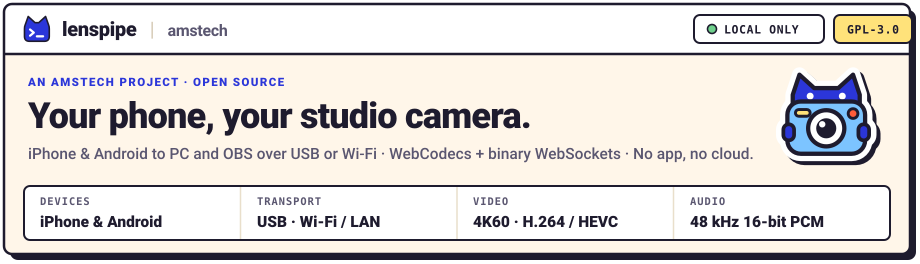
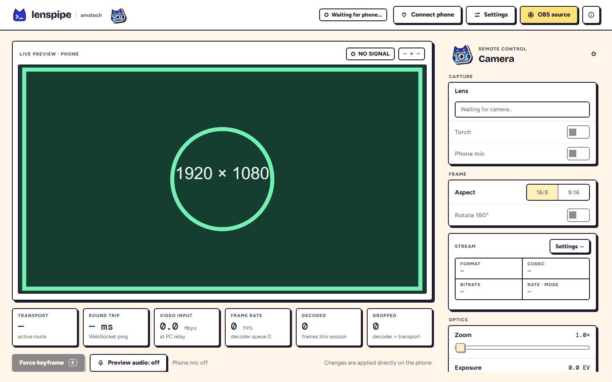
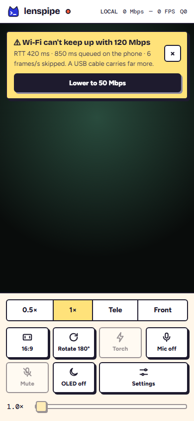
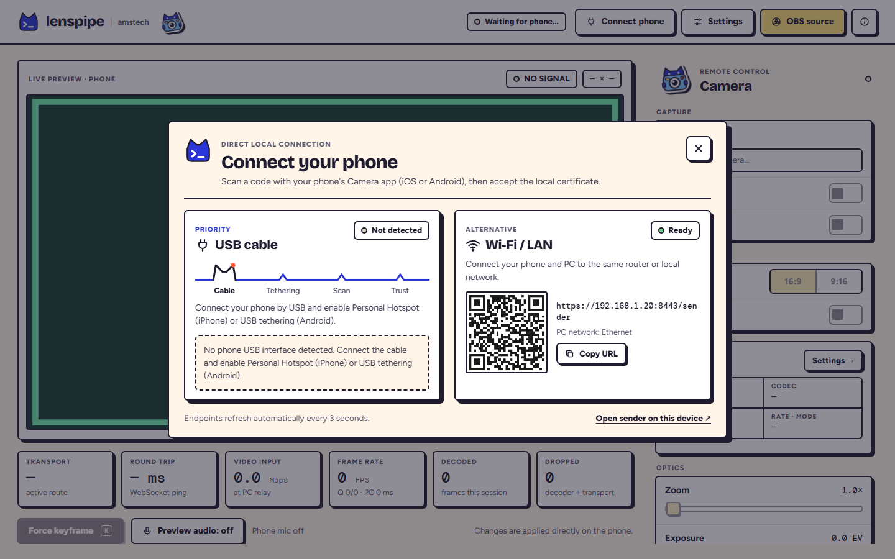

<p align="center">
  
</p>

<p align="center">
  <a href="#quick-start">Quick start</a> ·
  <a href="#connect">Connect</a> ·
  <a href="#controls-and-formats">Controls &amp; formats</a> ·
  <a href="#obs-studio">OBS Studio</a> ·
  <a href="#security-and-privacy">Security</a> ·
  <a href="#binary-protocol">Protocol</a> ·
  <a href="#design">Design</a>
</p>

Use your phone (**iPhone or Android**) as a low-latency studio camera on your PC and in OBS over a USB cable or Wi-Fi. Everything runs directly on your local network with **WebCodecs and binary WebSockets** — no phone app, no cloud relay, no account, no WebRTC, and no browser extension.

<p align="center">
  
  
</p>

<details>
<summary>More screenshots — connect dialog &amp; stream settings</summary>
<p align="center">
  
  
</p>
</details>

## Highlights

- **Cross-platform browser sender** — runs in iOS Safari 16.4+ and Android Chrome / Edge with WebCodecs, with automatic fallback across H.264 profiles (`High → Main → Constrained Baseline`), HEVC tiers, bitrate steps, and cropped frame sizes.
- **USB cable & Wi-Fi / LAN discovery** — Fastify HTTPS server generates local certificates on first launch and refreshes separate USB tethering (iPhone Personal Hotspot, Android RNDIS / USB-NCM) and Wi-Fi/LAN QR codes every 3 seconds.
- **16:9 video & 4:3 full-sensor formats** — `4K60`, `4K30`, `1080p60`, and `1080p30` video modes with full camera processing, plus `12 MP`, `1440p`, and `1080p60` `4:3` modes in locked landscape or portrait (`Rotate 180°` supported) with live wrong-way hold warnings.
- **Tuned for high bitrate & low latency** — H.264 or HEVC (`10–200 Mbps`), VBR or CBR, **Quality** (lookahead) or **Realtime** mode, one-tap **Max quality** / **Low latency** profiles, and persistent settings on the phone.
- **End-to-end flow control** — the relay acknowledges received bytes (coalesced every `25 ms`, flushed within `1 s` on idle) and the phone skips frames before encoding when more than ~`250 ms` of video — at the encoder's actual output rate — is unacknowledged. Slower links drop frames instead of building lag.
- **Low-delay H.264 output** — `src/h264-sps.ts` rewrites SPS `bitstream_restriction` to declare `max_num_reorder_frames = 0`, removing DPB buffering delay (~`430 ms` → `1–2 ms` measured on RTX 2060 SUPER) while automatically reverting if reordering is ever seen.
- **Full remote studio control** — swap lenses live, lock focus/exposure, tap/click preview to focus, adjust EV and zoom, keep torch lit across format/lens switches, blackout OLED screens (`OLED off`), and stream raw mono `16-bit PCM` mic audio (`AudioWorklet`) or omit audio completely.
- **Ready for OBS** — borderless `/obs` Browser source with automatic aspect-ratio framing, cached codec configs, per-receiver backpressure, and pairing-key protection.

> [!NOTE]
> H.264 and HEVC are lossy codecs: high bitrates, hardware encoding, and CBR where supported minimize compression artifacts. Because WebSockets run over TCP (no packet loss), periodic keyframes are spaced `2 s` apart so bits go into image detail; new receivers and congestion recovery request on-demand keyframes (throttled to `250 ms`).

---

## Requirements

| Component | Requirement |
| --- | --- |
| **PC** | Node.js `20+` and `npm` |
| **Phone** | **iOS Safari 16.4+** or **Android Chrome / Edge** with WebCodecs `VideoEncoder` |
| **USB (recommended)** | Data/sync cable + **Personal Hotspot** (iPhone) or **USB tethering** (Android) |
| **Wi-Fi / LAN** | PC and phone on the same LAN with AP/client isolation disabled |

> [!NOTE]
> Built and tested thoroughly on iPhone (Safari) and verified on Android (Samsung Galaxy A57, Chrome). On Android, secondary lens controls, HEVC support, and max hardware encoding bitrate vary by device and browser; LensPipe automatically steps down codec profile, bitrate, or size when a hardware encoder refuses a setting.

---

## Quick start

```sh
npm install
npm run build
npm start
```

For active development (watches both server TypeScript and Vite client bundles on one HTTPS origin):

```sh
npm run dev
```

Open **`https://localhost:8443/control`** on the PC. Set `PORT=...` before launch to change the default port (if busy, startup probes up to 10 consecutive ports). On Windows, allow Node.js through Windows Defender Firewall on **Private networks** when prompted.

First startup generates four gitignored files inside `certs/`:

```text
certs/local-key.pem      Local private key (never share or transfer)
certs/local-cert.pem     Name-constrained local CA certificate
certs/local-sans.json    SAN profile & IP list for automatic cert updates
certs/pairing-token      Random pairing key embedded in QR & OBS URLs (#k=...)
```

> [!TIP]
> Connect your preferred USB or Wi-Fi interface before the very first startup so its IP is included in `certs/local-cert.pem` right away. To reset certificates or revoke all paired devices, stop the server and remove `certs/` (or just `certs/pairing-token` to unpair devices).

---

## Connect

Click **Connect phone** in the top bar. USB connections appear under **Priority** whenever a cable tethering adapter is active; interfaces re-scan automatically every 3 seconds.

### USB cable (recommended)

- **iPhone:** plug in the USB cable, tap **Trust** if prompted, and open **Settings → Personal Hotspot → Allow Others to Join** (keep that screen open briefly until the interface appears; cellular service is not required for local USB streaming, and Personal Hotspot must stay enabled while streaming).
- **Android:** plug in the USB cable and turn on **USB tethering** in Android Settings (typically **Connections → Mobile Hotspot and Tethering**). On Windows, LensPipe detects RNDIS and USB-NCM tethering adapters alongside Apple USB interfaces.
- Scan the **USB cable** QR code with your phone camera, or copy the sender URL including `#k=…` (on iPhone Personal Hotspot, typically `https://172.20.10.x:8443/sender#k=…`).

> [!WARNING]
> **If the USB page never loads on Windows:** Windows often assigns new USB tethering adapters (*Apple Mobile Device Ethernet* or Android RNDIS) to the **Public** network profile, whereas the initial Node.js firewall prompt usually grants **Private** access only. The server detects this automatically and shows the exact one-line fix in **Connect phone** and the terminal:
> ```powershell
> New-NetFirewallRule -DisplayName 'LensPipe (local sender)' -Direction Inbound -Action Allow -Protocol TCP -LocalPort 8443 -RemoteAddress 172.20.10.0/28 -Profile Public
> ```
> Alternatively, change that USB adapter's **Network profile type** to **Private** in **Settings → Network & internet → Ethernet**.

### Wi-Fi / LAN

1. Connect both the phone and PC to the same router or local subnet.
2. Scan the **Wi-Fi / LAN** QR code in **Connect phone**, or copy the URL (`https://192.168.x.x:8443/sender#k=…`).
3. If the phone displays **Not paired**, scan the QR code again (browsers occasionally drop URL `#` fragments while accepting the local certificate warning).
4. If the page times out, check Windows Firewall rules, active VPN virtual adapters, AP/guest isolation on the router, and the selected PC network adapter.

### Trust the local certificate

Because `certs/local-cert.pem` is self-signed locally, your browser will warn once per IP:

- **Quick trust (iOS Safari & Android Chrome):** tap **Show Details / Advanced**, verify it matches your PC's local IP, and choose **visit this website** / **Proceed to … (unsafe)**.
- **Persistent trust on iPhone (optional):** copy **only** `certs/local-cert.pem` to the iPhone (never `local-key.pem`), install the profile in iOS Settings, and enable full trust under **Settings → General → About → Certificate Trust Settings**.

Upgrading from an older certificate without name constraints regenerates `certs/` once on startup; re-trust `certs/local-cert.pem` on your phone and in OBS if that happens.

---

## Controls and formats

### Quick profiles & defaults

| Profile | Format | Codec | Bitrate & control | Latency mode | Best for |
| --- | --- | --- | --- | --- | --- |
| **Default** | `4K30 · 16:9` | `H.264` | `60 Mbps · VBR` | `Quality` | Crisp detail with broad PC hardware decoding |
| **Max quality** | `4K30 · 16:9` | `HEVC` | `80 Mbps · VBR` | `Quality` | USB cable (`iPhone` & HEVC-capable devices) |
| **Low latency** | `1080p60 · 16:9` | `H.264` | `40 Mbps · CBR` | `Realtime` | Busy Wi-Fi and fast motion |

> [!TIP]
> On Windows, iPhone's USB network interface negotiates at `100 Mbps`, so bitrates near or above `100 Mbps` cannot fit down that cable. Whenever the network, phone encoder, or PC renderer falls behind, both `/sender` and `/control` raise a diagnostic health banner pinpointing the bottleneck with a one-tap fix (measured bitrate ceiling, lighter preset, or switching from HEVC to H.264).

### Video & photo formats

| Format | Dimensions | Frame rate | Ratio | Notes |
| --- | --- | --- | --- | --- |
| `4K60` | `3840 × 2160` | `60 fps` | `16:9` | Full video processing; main `1×` lens usually required for `60 fps` |
| `4K30` | `3840 × 2160` | `30 fps` | `16:9` | Default format; supported across rear & front lenses |
| `1080p60` | `1920 × 1080` | `60 fps` | `16:9` | High-motion stream with lower bandwidth demand |
| `1080p30` | `1920 × 1080` | `30 fps` | `16:9` | Lowest bandwidth `16:9` HD mode |
| `12 MP 4:3` | `4032 × 3024` | `30 fps` | `4:3` | Full sensor FOV; requires H.264/HEVC Level 6.0 PC GPU decode & may crop to max encoder limit |
| `1440p 4:3` | `1920 × 1440` | `30 fps` | `4:3` | Full-sensor FOV (`photo mode` warning on iOS) |
| `1080p60 4:3` | `1440 × 1080` | `60 fps` | `4:3` | High-frame-rate `4:3` capture (`photo mode` warning on iOS) |

> **4:3 photo modes:** On iPhone, `4:3` modes come from Safari photo capture paths with less temporal noise reduction, video HDR, and tone mapping than `16:9` video modes, so the UI flags them accordingly.

### Phone sender (`/sender` & `/diag`)

- **Lenses & live resizing:** switch lenses (`0.5×`, `1×`, `Tele`, `Macro`, `Auto`, `Front` / `Back N`) without disconnecting the WebSocket. Changing preset resizes the live track in place (detaching and re-cloning the iOS Safari worker track cleanly so resolution changes take effect immediately), restoring the torch afterwards whenever a camera reopen is unavoidable.
- **Locked aspect & hold warning:** **16:9 / 9:16** (or **4:3 / 3:4**) locks output dimensions so the picture never flips on its own. **Rotate 180°** supports upside-down mounts. When the phone is held sideways against the selected aspect or upside down (keep Rotation Lock off on mobile), both screens offer a one-tap fix.
- **Capture & encoder resilience:** reads frames via `MediaStreamTrackProcessor` on the main thread (Android Chrome / Chromium), a dedicated Worker on iOS Safari (`src/sender/capture-worker.ts`), or `<video>` `requestVideoFrameCallback` fallback. Automatically handles `H.264 High → Main → Constrained Baseline`, `HEVC High → Main`, `quality → realtime`, `VBR ↔ CBR`, `HEVC → H.264`, full-resolution bitrate step-downs (`10–200 Mbps`), and cropped size limits.
- **Audio & OLED blackout:** optional mono `16-bit PCM` mic capture over `AudioWorklet` (`echoCancellation`, `noiseSuppression`, and `autoGainControl` disabled; omitted completely when off to save ~`0.77 Mbps` at `48 kHz`). **OLED off** blanks the screen completely using Wake Lock + silent media keep-alive; press and hold anywhere for **2 seconds** (or press **Escape** on a keyboard) to exit.
- **Diagnostics (`/diag`):** open `https://<host>:8443/diag` on any phone and tap **Run test** to benchmark every lens's real supported resolutions and frame rates, saving JSON reports under `diagnostics/`.

### PC studio (`/control`)

- **Live preview & remote panel:** click anywhere on the canvas to trigger point/pass autofocus, press `K` (or **Force keyframe**) for an immediate keyframe, toggle **Preview audio: on/off** (adaptive jitter buffer: starts at `60 ms`, steps `+20 ms` up to `250 ms` on dropouts, shrinks back after `5 s`), and inspect **Settings** or **About** (`ⓘ`).
- **Telemetry & PC latency:** live transport (`USB` / `Wi-Fi`), RTT, relay input bitrate, FPS, encoder/decoder queue depths, PC decode+draw time (`npm run measure:pc` measures it from CLI while streaming), decoded frames, and drops.
- **iOS Realtime note:** iOS Safari caps `realtime` mode near ~`15 Mbps`, whereas `quality` mode unlocks full requested bitrates at ~`11 ms` lookahead cost on iPhone.

---

## OBS Studio

1. Add **Sources → Browser**.
2. Click **OBS source** in `/control` to copy the exact authenticated URL (including `#k=…`), for example:
   ```text
   https://192.168.1.20:8443/obs
   ```
   *(Shift-click **OBS source** to preview `/obs` in a browser tab.)*
3. Set OBS Browser width and height to match your scene canvas (e.g. `1920 × 1080`), and optionally enable **Refresh browser when scene becomes active**.
4. Enable **Control audio via OBS** if you want the phone mic routed to OBS's audio mixer (click the view once if OBS suspends Web Audio).

If OBS's embedded Chromium rejects the local self-signed HTTPS certificate, import `certs/local-cert.pem` into your **Current User → Trusted Root Certification Authorities** store and restart OBS:

```powershell
Import-Certificate -FilePath .\certs\local-cert.pem -CertStoreLocation Cert:\CurrentUser\Root
```

> [!CAUTION]
> Only import a certificate generated on your own PC, and never launch OBS with global `--ignore-certificate-errors` flags for normal use.

---

## Security and privacy

- **Pairing key (`certs/pairing-token`):** every device other than the PC itself must present the random pairing token embedded after `#k=` in QR codes and the copied OBS URL (URL fragments are never logged on the server). Pages opened locally on the PC (`Host` is `localhost` or a local interface IP, with no forwarding proxy headers such as `X-Forwarded-For` / `Forwarded`) skip the token automatically, preventing reverse proxies or tunnels (`ngrok`, Dev Tunnels, Tailscale Funnel, `netsh portproxy`) from granting keyless access. Delete `certs/pairing-token` and restart to revoke all paired devices.
- **Same-origin WebSockets & CSP:** `/ws/sender`, `/ws/control`, and `/ws/obs` reject cross-origin upgrades; all pages serve strict `Content-Security-Policy` (`'self'`), `X-Content-Type-Options: nosniff`, `Referrer-Policy: no-referrer`, and `X-Frame-Options: SAMEORIGIN`, with WebSocket payloads capped at `32 MiB`.
- **Name-constrained local CA:** `certs/local-cert.pem` carries X.509 Name Constraints restricting it exclusively to `localhost` and private IPv4 ranges (`127.0.0.0/8`, `10.0.0.0/8`, `172.16.0.0/12`, `192.168.0.0/16`) so it can never vouch for any public domain.

---

## Binary protocol

Every media and control WebSocket message uses a 1-byte packet header; timestamps are big-endian `Float64` microseconds (`8` bytes).

| Tag | Payload |
| --- | --- |
| `0x01` | UTF-8 JSON video `decoderConfig` & orientation metadata (base64 codec extradata) |
| `0x02` | 8-byte timestamp + encoded H.264/HEVC keyframe (`EncodedVideoChunk`) |
| `0x03` | 8-byte timestamp + encoded delta frame (`EncodedVideoChunk`) |
| `0x04` | UTF-8 JSON PCM audio `decoderConfig` (`pcm-s16le`) |
| `0x05` | 8-byte timestamp + little-endian signed 16-bit mono PCM chunk |
| `0x10` | UTF-8 JSON control messages (commands, batched `set-encoding`, sender/studio state, ping/pong, telemetry, flow-control `ack`) |

`StreamRelay` (`server/relay.ts`) caches the latest `0x01` and `0x04` metadata packets so newly connected `/control` and `/obs` receivers start decoding on the very next keyframe, forwards video packet buffers zero-copy, and enforces per-receiver backpressure (`~200 ms` queue / `1.5 MiB` minimum high-water mark) so a backgrounded tab never stalls live receivers.

### Project layout

```text
server/
  index.ts             Fastify HTTPS server, security headers, port probing, diagnostics endpoint
  certificates.ts      Name-constrained local CA generation & SAN management
  network.ts           USB tethering (iPhone/Android) & LAN scanner + Windows firewall check
  pairing.ts           Persistent pairing token & strict local-request verification
  relay.ts             Zero-copy WebSocket relay, config cache, per-receiver backpressure
src/
  sender/              Phone capture, worker reader, WebCodecs encoder & camera hardware controls
  control/             PC dashboard, QR connection modal, stream settings, About & live telemetry
  obs/                 Borderless OBS Browser source
  diag/                Per-lens resolution/FPS diagnostics probe (/diag)
  amstech-ui/          Bundled AMSTech UI v1.0 tokens, components & offline WOFF2 fonts
  amstech-ui.ts        Range progress painter & USB steps bar helper
  receiver.ts          Shared WebCodecs VideoDecoder & adaptive PCM AudioWorklet player
  h264-sps.ts          Low-delay H.264 VUI SPS rewriter (max_num_reorder_frames = 0)
  health.ts            Hysteresis link/encoder/PC bottleneck detector & suggested fixes
  protocol.ts          Binary packet framing & extradata serialization
  stream-settings.ts   Formats, profiles, rotation math & codec level/profile helpers
  pairing.ts           Client fragment key storage & header attachment
  socket.ts            BinarySocket with ack tracking & reconnection
public/                favicon.svg, pcm-capture-worklet.js, pcm-player-worklet.js
scripts/               Unit, relay, audio, latency & headless Chrome UI suites
docs/
  brand/               README brand SVGs (banner.svg, seal.svg)
  screenshots/         Verified UI screenshots regenerated via npm run screenshots
```

---

## Verification & contributing

```sh
npm run typecheck      # Server & client TypeScript check
npm run build          # Production build into dist/ and dist-server/
npm test               # All 6 unit suites: receiver, H.264 SPS, health, pairing, orientation, formats
```

With the production server running (`npm start`):

```sh
npm run test:relay     # HTTPS assets, cached configs, keyframe relay & throughput smoke test
npm run test:ui        # Headless Chrome layout checks at 1440×900, 390×844 & 844×390
npm run screenshots    # Regenerate README screenshots in docs/screenshots/
npm run test:audio     # Bursty simulated mic playback check without audio dropouts
npm run measure:pc     # Measure live PC decode+draw pipeline latency from CLI
```

Browser checks auto-detect Chrome/Chromium via `scripts/chrome-path.mjs` or use `CHROME_PATH` when set.

Pull requests and issues are welcome. Before opening a PR, run `npm run typecheck`, `npm test`, and `npm run test:ui` (for UI edits). Camera/WebCodecs changes must be verified on real phone hardware (desktop browsers cannot emulate mobile camera lenses or mobile WebCodecs hardware encoders) — please note your phone model, browser, and OS version.

---

## Design

LensPipe follows the **AMSTech brand manual v1.5 («stickers only»)** implemented via the offline-bundled package in [`src/amstech-ui/`](src/amstech-ui/README.md) (so every asset stays `'self'`-hosted under strict CSP):

| Element | Specification |
| --- | --- |
| **Palette (always light)** | Cream paper `#FFF6E9`, white cards `#FFFFFF`, ink `#1E1B2E`, `2.5 px` ink borders, `6 px` corners, hard ink shadows |
| **Accents** | Cobalt `#2B36D9` (one primary CTA per view), yellow `#FFE27A` (selection, highlight & warning), sky blue `#7CC4FF` (camera body) |
| **Typography** | **Bricolage Grotesque** (display & headings), **Figtree** (UI copy), **DM Mono** (figures & URLs) — bundled under SIL OFL |
| **Stickers & logo** | Cobalt **Thor** terminal head logo (`>_` + `\| amstech`), custom **Thor cámara** die-cut sticker, and USB chapter-bar ears (boxes remain ear-free) |

---

<p align="center">
  
</p>

<p align="center">
  <strong>An AMSTech project</strong> · Built for me, shared with all · <a href="https://amstech.dev">amstech.dev</a>
  <br>
  <a href="LICENSE">MIT License</a> © AMSTech
</p>
